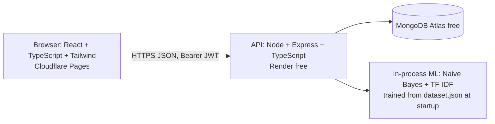

# SmartResolve AI

Intelligent issue reporting, routing and resolution for a fictional college campus. A reporter files a complaint; a trained text classifier suggests the department, a similarity engine flags possible duplicates, deterministic rules set priority and pick the staff member with the lowest workload; staff resolve it, the reporter confirms, and the admin sees live analytics. Built for the ACE Digital 7-day internship assignment.

> **Everything here is synthetic.** No real people, records or credentials. The demo accounts below are dummy accounts.

## Live demo

| | URL |
|---|---|
| Web app | _add after deployment_ |
| API health | _add after deployment_ (`/health`) |
| Repository | _add after pushing_ |

The API runs on Render's free tier and sleeps after ~15 min idle: the first request can take about a minute. The app shows a "waking up" message and retries automatically.

### Demo accounts (dummy, for evaluation only)

Password for every account: `Demo@12345`

| Role | Email |
|---|---|
| Reporter A | `reporter.a@example.test` |
| Reporter B | `reporter.b@example.test` |
| Reporter C / D | `reporter.c@example.test` / `reporter.d@example.test` |
| IT Staff | `it.staff1@example.test`, `it.staff2@example.test` |
| Facilities Staff | `facilities.staff@example.test` |
| Administration Staff | `admin.staff@example.test` |
| Administrator | `admin@example.test` |

Reporters can also self-register. Staff and admin accounts are created only by the seed script; registration can never choose a role.

## What it does

- **Roles & permissions** — Reporter, Department Staff, Administrator; every rule enforced by the API (see [docs/SECURITY.md](docs/SECURITY.md)).
- **Report an issue** — validated form, server-owned ID/reporter/timestamps, safety-hazard flag with emergency-contact guidance.
- **Trained classifier** — Naive Bayes written from scratch, trained on a reviewed synthetic dataset; low confidence goes to an admin **Needs Review** queue instead of guessing.
- **Duplicate suggestions** — TF-IDF cosine similarity + building/room/department evidence; up to 3 candidates, never auto-merged. Admin can explicitly link.
- **Explainable priority** — deterministic score (urgency, impact, hazard) shown with its factors; admin override requires a reason.
- **Routing** — predicted department → active staff with the fewest ASSIGNED + IN_PROGRESS cases (ties by staff ID).
- **Workflow** — OPEN → ASSIGNED → IN_PROGRESS → RESOLVED → CLOSED, resolution note required, reporter closes or reopens with a reason, append-only history.
- **SLA / overdue** — computed on read from stored timestamps (no cron).
- **Analytics** — counts by status/department/priority, overdue, resolution time, staff workload, with a reconciliation check.

## Architecture



```
client/                React app (Vite)
server/src/routes      auth, issues, issueActions, analytics, admin
server/src/services    priority, sla, statusMachine, routing, duplicates, analytics (pure, unit-tested)
server/src/ml          dataset.json, naiveBayes.ts, evaluate.ts, train.ts
server/src/models      Mongoose: User, Department, Issue, ActivityLog, Counter
server/src/tests       Vitest + Supertest (in-memory MongoDB)
server/seed            demo accounts + 36 synthetic tickets
docs/                  API, security, test matrix, deployment, ML evaluation
```

Data model (MongoDB): `users`, `departments`, `issues` (indexed on code, reporter, department, assignee, status, createdAt), `activitylogs` (append-only), `counters`. The model version and evaluation metrics are stored in `server/src/ml/metrics.json`.

## AI approach

- **Classifier** — multinomial Naive Bayes, Laplace smoothing, tokenisation + normalisation + light stemming. Trained from `server/src/ml/dataset.json` (120 synthetic, human-reviewed examples; 30 train + 10 held-out test per department). `npm run train` reproduces the evaluation.
- **Result on the 30 held-out cases: 93.3% accuracy (28/30)**; see [docs/ml-evaluation.md](docs/ml-evaluation.md) for per-class precision/recall, the confusion matrix and the two misclassified cases. A small synthetic dataset cannot support a real-world reliability claim, and the confidence score is **not calibrated**.
- **Manual review** — a prediction goes to the admin queue if confidence < 0.65 (tunable starting value), margin between the top two classes < 0.10, or fewer than 2 known words.
- **Duplicates** — TF-IDF over normalised, stemmed, synonym-collapsed text (wifi ≈ internet ≈ network); cosine + 0.10 same building + 0.10 same room + 0.05 same department; threshold **0.55**; candidates in a different known department are skipped. Threshold was not tuned beyond the brief's starting value.
- **Priority** — `score = 2×urgency + impact + 5 if hazard`; P1 if hazard or score ≥ 11, P2 8–10, P3 5–7, P4 ≤ 4. Note: without a hazard the maximum score is 9, so P1 is effectively hazard-only; the rule is kept exactly as specified.

## Run locally

Requirements: Node 22+ and a MongoDB (Atlas free cluster or local).

```bash
cp .env.example server/.env          # edit MONGODB_URI and JWT_SECRET
cd server && npm install
npm run seed                          # departments + accounts + 36 tickets (skips tickets if any exist)
npm run dev                           # API on :4000

cd ../client && npm install
npm run dev                           # app on :5173
```

Useful commands (in `server/`): `npm test`, `npm run typecheck`, `npm run build`, `npm run train`, `npm run seed:reset` (**wipes all tickets and history**, then re-seeds; run shortly before a demo so ages are fresh).

## Documentation

- [API reference](docs/API.md)
- [Security notes and risk list](docs/SECURITY.md)
- [Test matrix](docs/TEST-MATRIX.md)
- [Deployment guide (free tier)](docs/DEPLOYMENT.md)
- [Classifier evaluation](docs/ml-evaluation.md)

## Known limitations

- Duplicate suggestions appear after a report is saved, not as a preview on the form.
- Any staff member of the right department can move a ticket, not only the assigned person.
- An admin moving a ticket to In Progress does not count as the staff first response.
- JWT is kept in `localStorage`; there is no token revocation other than deactivating the account.
- Login rate limiting is in memory (resets on restart, per instance).
- Mobile (375 px) layout and the cold-start retry UI have not yet been verified on a real device; see the test matrix.
- No email/SMS, file uploads, chatbots or real emergency dispatch (out of scope per the brief).
